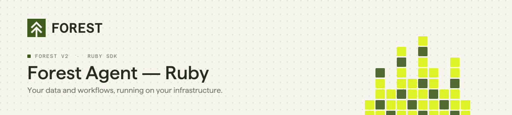
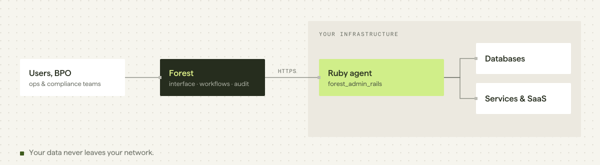

<p align="center">
  <picture>
    <source media="(prefers-color-scheme: dark)" srcset="./assets/header-agent-ruby-dark.svg">
    
  </picture>
</p>

<p align="center">
  <a href="https://rubygems.org/gems/forest_admin_rails"></a>
  <a href="https://github.com/ForestAdmin/agent-ruby/actions/workflows/build.yml"></a>
  <a href="./LICENSE"></a>
</p>

**Forest is the back office for operations teams in regulated companies.** Ops teams review, decide and act on your data from one interface, or let AI agents do it, within the roles, permissions and audit logs you define.

This repository is the **Ruby agent**: the part of Forest that runs inside your Rails application, connects to your databases and services, and exposes them to the Forest interface. Your business data never goes through Forest.

> [!NOTE]
> **Forest v2.** This is the current Ruby SDK. Using the `forest_liana` gem? You are on v1: see [forest-rails](https://github.com/ForestAdmin/forest-rails) and the [migration guide](https://docs.forest.app/guides/migration/from-v1/overview).

## Quick start

```ruby
# Gemfile
gem 'forest_admin_rails'
```

```bash
bundle install
bundle exec rails generate forest_admin_rails:install <FOREST_ENV_SECRET>
```

The generator mounts the engine, and creates the initializer and the agent entry point:

```ruby
# config/initializers/forest_admin_rails.rb
ForestAdminRails.configure do |config|
  config.auth_secret = ENV['FOREST_AUTH_SECRET']
  config.env_secret  = ENV['FOREST_ENV_SECRET']
end
```

```ruby
# lib/forest_admin_rails/create_agent.rb
module ForestAdminRails
  class CreateAgent
    def self.setup!
      database_configuration = Rails.configuration.database_configuration
      datasource = ForestAdminDatasourceActiveRecord::Datasource.new(database_configuration[Rails.env])

      @create_agent = ForestAdminAgent::Builder::AgentFactory.instance.add_datasource(datasource)
      customize
      @create_agent.build
    end

    def self.customize
      # Add computed fields, actions, segments and hooks here
    end
  end
end
```

Environment variables: `FOREST_ENV_SECRET`, `FOREST_AUTH_SECRET`, and `FOREST_SERVER_URL` if you target a dedicated instance.
Full guide: [docs.forest.app/get-started/quickstart](https://docs.forest.app/get-started/quickstart)

## Requirements

| | |
|---|---|
| Ruby | `>= 3.0` (CI tests 3.4 and 4.0) |
| Rails | `>= 6.1` |

## What the agent gives you

| | |
|---|---|
| **Data** | ActiveRecord, Mongoid, Snowflake, Zendesk, GraphQL/Hasura, Mambu, Pylon, RPC: one data source package per source. |
| **Customization** | Computed fields, actions, segments, hooks and relationships through `forest_admin_datasource_customizer`. |
| **Permissions and audit** | Roles, scopes and activity logs defined in Forest, enforced on every request. |
| **Testing** | `forest_admin_test_toolkit` to test your customizations. |

## How it works

<picture>
  <source media="(prefers-color-scheme: dark)" srcset="./assets/arch-agent-ruby-dark.svg">
  
</picture>

The agent runs **on your infrastructure**. The Forest interface calls your agent, and your agent queries your sources: Forest does not store your business data.

## Documentation

| | |
|---|---|
| Get started | https://docs.forest.app/get-started/quickstart |
| Connect a data source | https://docs.forest.app/get-started/connect/data-sources/overview |
| Ruby API reference | https://docs.forest.app/reference/agent-api/ruby |
| Migrating from v1 | https://docs.forest.app/guides/migration/from-v1/overview |

<details>
<summary><b>Packages in this monorepo</b></summary>

`forest_admin_rails` · `forest_admin_agent` · `forest_admin_rpc_agent` · `forest_admin_datasource_toolkit` · `forest_admin_datasource_customizer` · `forest_admin_datasource_active_record` · `forest_admin_datasource_mongoid` · `forest_admin_datasource_snowflake` · `forest_admin_datasource_zendesk` · `forest_admin_datasource_graphql_hasura` · `forest_admin_datasource_mambu_payments` · `forest_admin_datasource_pylon` · `forest_admin_datasource_rpc` · `forest_admin_test_toolkit`

A complete demo application lives in [`packages/_examples/demo`](./packages/_examples/demo).

</details>

## Contributing

Bug reports and pull requests are welcome. See [CONTRIBUTING.md](./CONTRIBUTING.md) for setup, tests and commit conventions.

```bash
cd packages/<package>
BUNDLE_GEMFILE=Gemfile-test bundle install
BUNDLE_GEMFILE=Gemfile-test bundle exec rspec
```

## License

Apache 2.0. See [LICENSE](./LICENSE).
